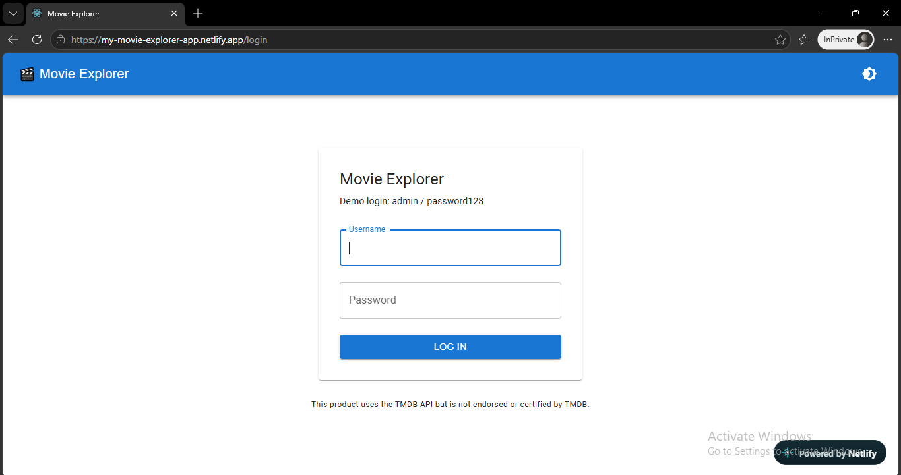
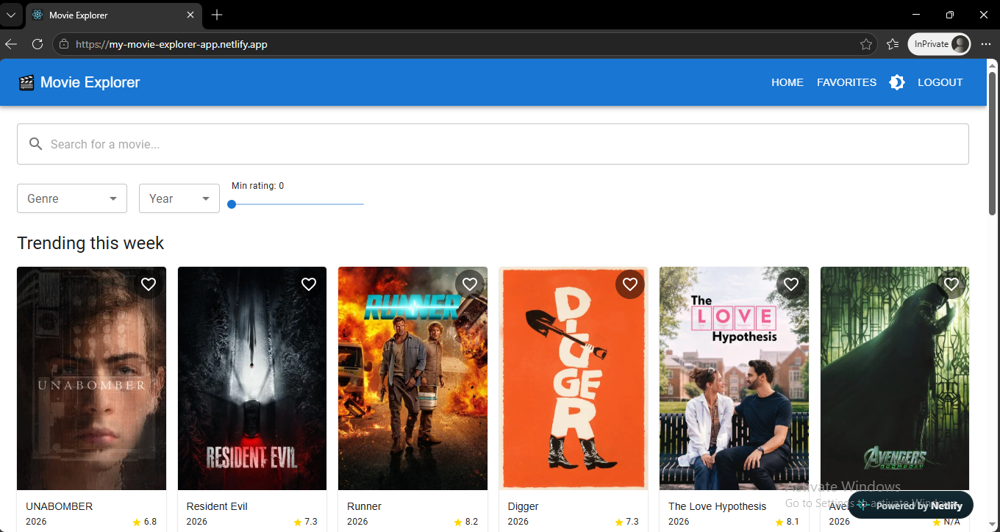
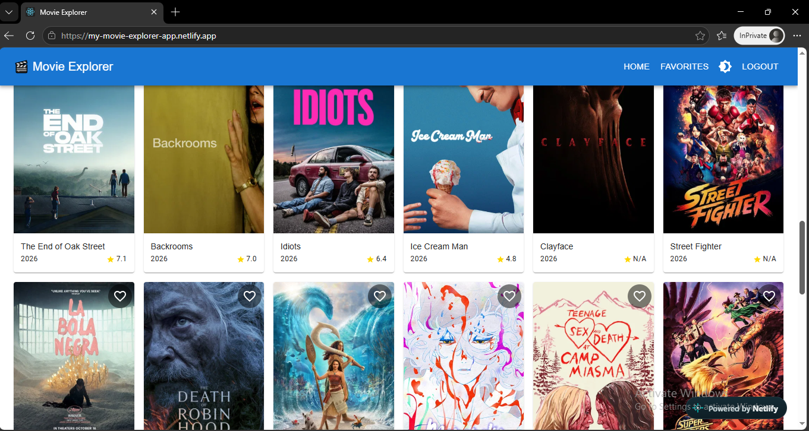
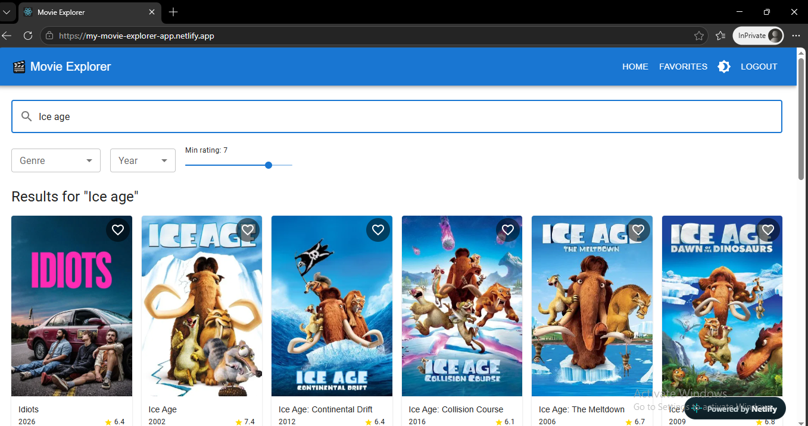
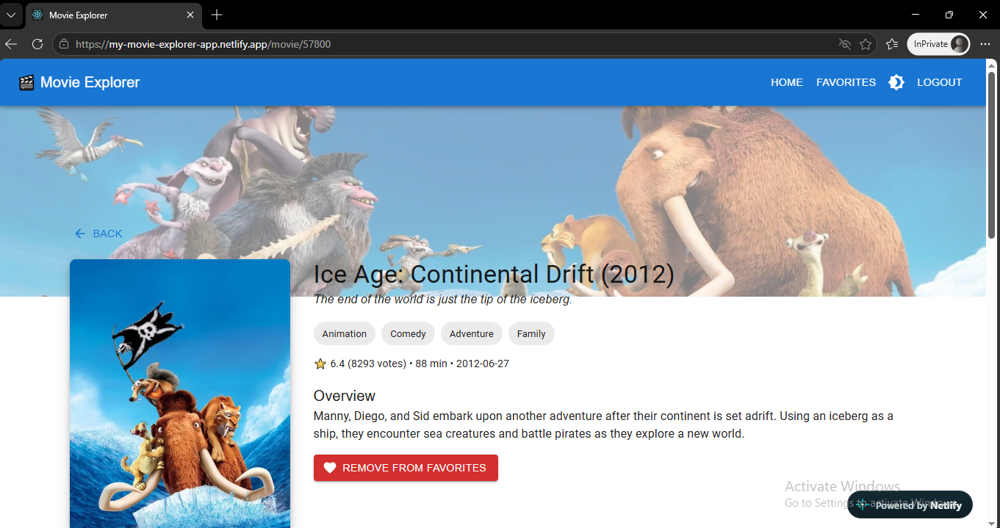
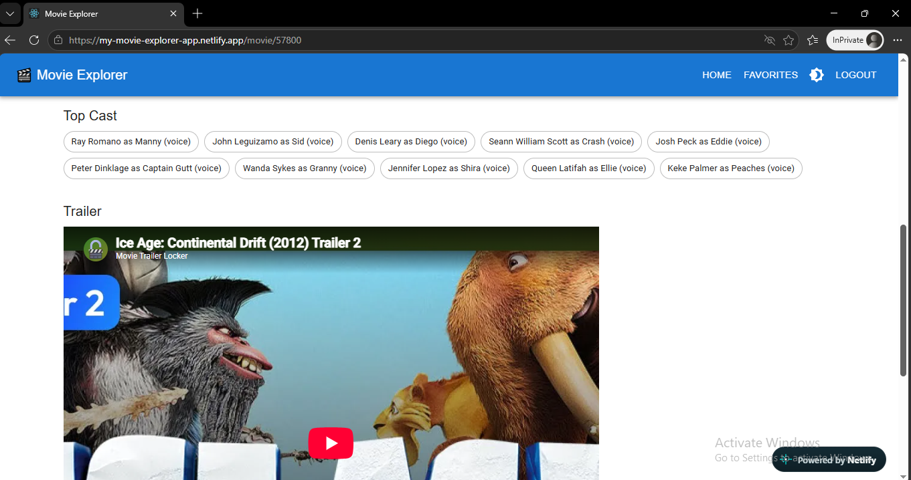
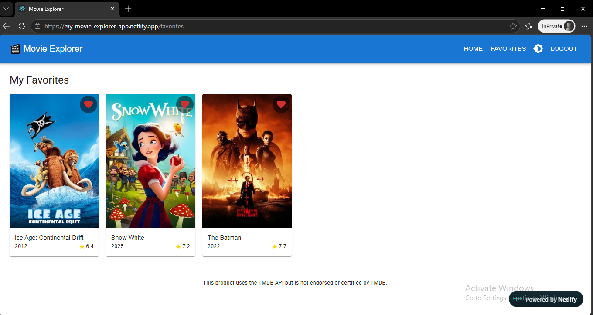
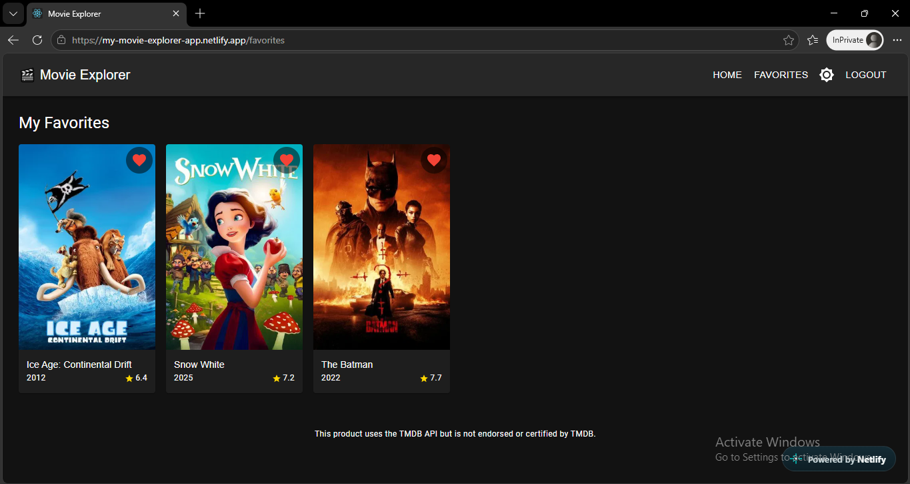
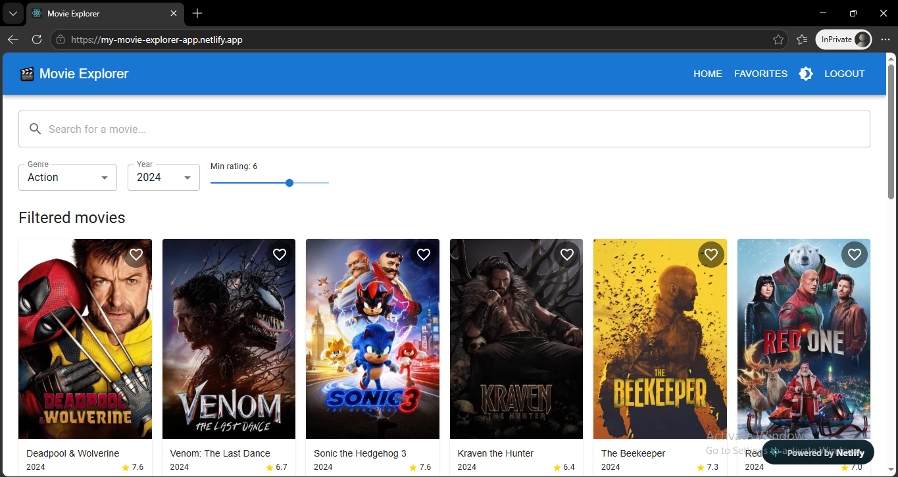

# 🎬 Movie Explorer

A React web app to search movies, browse trending films, view details and trailers, and save favorites, powered by the TMDb API.

**Live demo:** my-movie-explorer-app.netlify.app

**Source code:** https://gitlab.com/personal-group9644440/my-react-movie-app

## Demo login

- Username: `admin`
- Password: `password123`

Authentication is simulated on the client because the task has no backend. The session is stored in localStorage.

## Screenshots

| Login                           | Home (Trending)               |
| ------------------------------- | ----------------------------- |
|  |  |

| Home (Load More)                 | Search                            |
| -------------------------------- | --------------------------------- |
|  |  |

| Movie details                       | Trailer                                   |
| ----------------------------------- | ----------------------------------------- |
|  |  |

| Favorites                               | Dark mode                               |
| --------------------------------------- | --------------------------------------- |
|  |  |

### Filtered results



## Features

**Required**

- Login page with validation and protected routes
- Trending movies from TMDb
- Debounced movie search with infinite scrolling
- Movie grid showing poster, title, release year and rating
- Movie details page: overview, genres, cast, runtime, rating and trailer
- Light/dark mode (remembered between visits)
- Favorites list saved in localStorage
- Last searched movie saved in localStorage and restored on reload
- State management with the React Context API
- Friendly error handling (network errors, no results, movie not found)
- Mobile-first responsive design

**Bonus**

- Filter by genre, year and minimum rating
- "Load More" button on the trending section
- Embedded YouTube trailers

## Tech stack

React (Create React App), Material-UI (MUI), React Router, Axios, TMDb API. Deployed on Netlify.

## Setup

1. Clone the repository and install dependencies:

```bash
   npm install
```

2. Copy `.env.example` to `.env` and add your TMDb **API Read Access Token** (TMDb → Settings → API):

```
   REACT_APP_TMDB_TOKEN=your_token_here
```

3. Start the app:

```bash
   npm start
```

4. Open http://localhost:3000

## TMDb API usage

| Purpose                    | Endpoint                                            |
| -------------------------- | --------------------------------------------------- |
| Trending movies            | `GET /trending/movie/week`                          |
| Search                     | `GET /search/movie`                                 |
| Details, cast and trailers | `GET /movie/{id}?append_to_response=credits,videos` |
| Genre list                 | `GET /genre/movie/list`                             |
| Filtered browsing          | `GET /discover/movie`                               |

Requests go through a shared Axios instance (`src/api/tmdb.js`) using a Bearer token. Images are loaded from `https://image.tmdb.org/t/p/`.

## Project structure

```
src/
├── api/         TMDb requests and image URL helper
├── context/     ThemeContext, AuthContext, MovieContext
├── components/  MovieCard, MovieGrid, SearchBar, Filters, Navbar, ErrorMessage, ProtectedRoute
├── hooks/       useInfiniteScroll
└── pages/       Login, Home, MovieDetails, Favorites
```

## Design decisions and notes

- The search input is debounced (500 ms) to avoid a request on every keystroke.
- Infinite scroll uses the `IntersectionObserver` API.
- Search and filter results use infinite scroll, while the trending section uses a "Load More" button.
- The TMDb token is bundled into the frontend, so it is visible in the browser. This is acceptable for a demo; a production app would proxy requests through a backend.
- Possible improvements: real authentication, unit tests, TV shows, request caching.

---

This product uses the TMDB API but is not endorsed or certified by TMDB.
